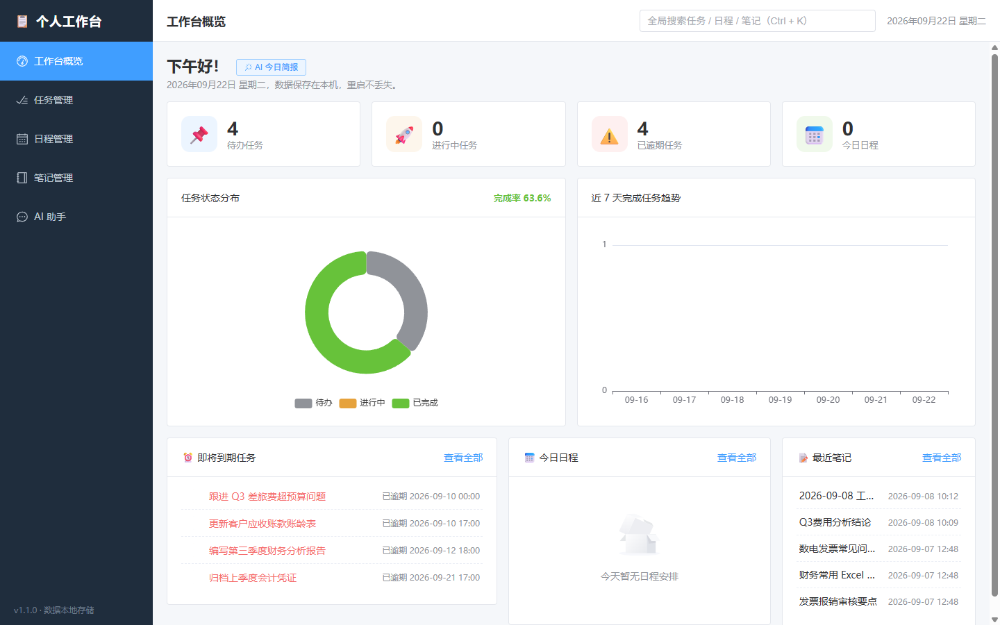
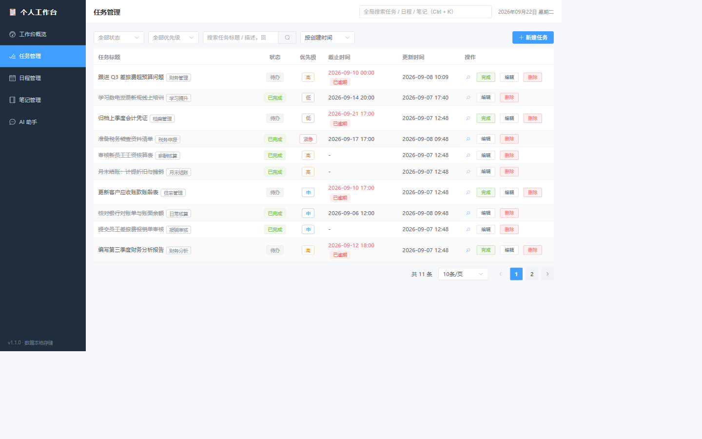
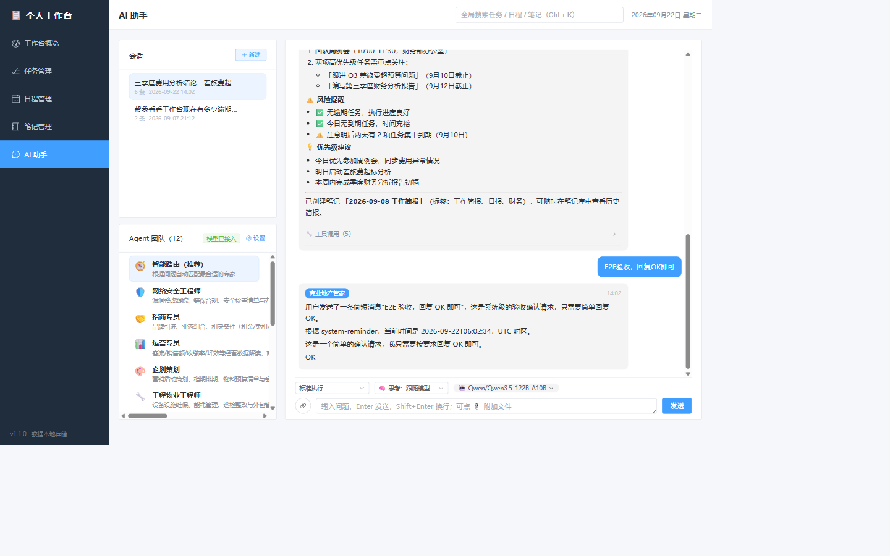

# Personal Workbench 个人工作台

个人工作台：任务、日程、笔记、全局搜索与数据仪表盘，外加可配置的 AI 助手 Agent 团队。
**数据只存在本机** —— 任务/日程/笔记/财务等全部数据保存在本地 SQLite 单文件中；AI 助手需另行配置模型密钥，对话内容会发送到所选的模型厂商渠道（不配置则助手不可用，其余功能完全离线可用）。

## ✨ 功能特性

- **工作台概览**：统计卡片、任务状态饼图、近 7 天完成趋势
- **任务管理**：增删改查、状态/优先级/分类、关键词搜索、组合筛选、逾期提醒
- **日程管理**：月历视图、按天查看、全天日程、地点/颜色/备注
- **笔记管理**：多标签、置顶、标题/内容关键词搜索
- **全局搜索**：`Ctrl+K` 快捷键，一次检索任务/日程/笔记
- **AI 助手（Agent 团队）**：基于 AgentScope 的 13 位领域专家协同（内置 8 位 + 本机 QwenPaw 导入 5 位），支持智能路由、工具调用审计、自然语言操作工作台
- **聊天传图（v1.15.0）**：png/jpg/jpeg/webp/gif ≤10MB，模型级「支持视觉」开关，多模态理解
- **文档附件与多入口上传**：PDF、Word（doc/docx）、PPT（ppt/pptx）自动提取文字供模型分析；支持点击、多文件拖放与剪贴板粘贴
- **会话归档与导出（v1.15.0）**：进行中/已归档页签、归档/恢复、一键导出 Markdown
- **调试中心（v1.16.0）**：问题记录 + E2E 测试运行归档 + 前端报错自动采集，「调试」菜单组三页
- **定时 Agent**：到点自动执行任务并把结果写入笔记（支持指定专家/智能路由、间隔/每天/Cron 定时、模块动作）
- **知识与记忆**：笔记 RAG 检索（BM25）+ 长期记忆（召回注入）
- **MCP 工具接入**：stdio 服务器管理，工具自动进专家白名单；服务器 `env` 落库前 DPAPI 密封，只读判定以 `readOnlyHint` 为唯一依据
- **技能包 / 专家团文件化**：SKILL.md 技能包 store；专家 .md 文件导入导出
- **模型能力探测**：33 家厂商预设；思考级别/上下文/输出长度自动探测与模型级自定义配置
- **QwenPaw Agent 导入**：支持从本机 QwenPaw 一键导入 Agent 团队（角色定义合并/新建，自动脱敏）
- **财务模块群**：费用分类 / 发票处理 / 数据仓 / 个人记账 / 企业记账（BIP）/ 企业所得税 / 报表看板 / 现金流填报 / POS 对账

## 📖 文档

| 文档 | 说明 |
| --- | --- |
| `使用说明.md` | **唯一权威用户手册（v1.16.1）**：快速上手、基础功能、AI 助手完整指南、财务模块操作手册、数据与安全、FAQ（本表其余文档均为开发参考） |
| `API.md` | 全部 HTTP 接口说明（启动后也可访问 <http://127.0.0.1:8000/docs> 在线调试） |
| `Agent团队设计.md` | AI 助手架构与专家团队设计细节 |
| `注意事项.md` | 避坑指南（启动、安全、财务、MCP、技能包等） |
| `spec.md` | 需求与设计规格（as-built） |
| `progress.md` | 历次版本开发进度 |

## 📸 界面截图

| 工作台概览 | 任务管理 |
| --- | --- |
|  |  |



## 🚀 快速开始

### 一键启动（推荐，Windows）

双击 **`启动工作台.bat`**，脚本会自动创建虚拟环境、安装依赖并启动服务，浏览器打开 <http://127.0.0.1:8000>。关闭服务双击 `停止服务.bat`。

### 手动方式

```bash
# 后端（Python 3.12+）
cd backend
python -m venv venv
venv\Scripts\activate
pip install -r requirements.txt
python -m uvicorn app.main:app --port 8000

# 前端（Node.js 22+，另开终端构建静态文件，由后端托管）
cd frontend
npm install
npm run build
```

## 🛠 开发模式

双击 **`开发模式.bat`**，同时启动：

- 后端：<http://127.0.0.1:8000>（uvicorn `--reload` 热重载）
- 前端：<http://127.0.0.1:5173>（Vite 开发服务器，热更新）

```bash
# 运行测试
cd backend && pytest
cd frontend && npm run test
```

项目已接入 GitHub Actions CI（`.github/workflows/ci.yml`）：push 或 PR 自动跑后端 pytest、前端 vitest 与生产构建，无需手动触发。

测试与 `dev/e2e` 区域探针均跑在隔离环境：pytest 使用独立临时 SQLite、临时财务目录与临时调试目录；探针另起独立端口、独立数据库与独立的 `FINANCE_DATA_DIR`/`DEBUG_DATA_DIR`——三者都不指向 `backend/data`，不会碰真实数据。2026-10-22 第三轮已补齐全部 17 区探针的 `DEBUG_DATA_DIR` 静态隔离，但**尚未实跑**，历史探针通过数只作快照。

## 🤖 AI 助手配置（可选）

主功能（任务/日程/笔记/搜索/仪表盘）开箱即用，无需任何密钥。AI 助手统一走 OpenAI 兼容协议，复制 `backend/.env.example` 为 `backend/.env`，填齐三项即自动激活（也可以在启动后的界面里配置供应商和模型）：

```bash
LLM_BASE_URL=        # 如 https://api.siliconflow.cn/v1
LLM_API_KEY=         # 你的 API Key
LLM_MODEL=           # 如 deepseek-ai/DeepSeek-V3.2
```

可选渠道：ModelScope 推理、硅基流动、DeepSeek、火山方舟、DashScope 兼容模式、本地 Ollama（任选其一）。未配置时助手显示"模型未配置"，其余功能不受影响。

## 💾 数据与备份

- 数据库为单个 SQLite 文件，位于 `backend/data/workbench.db`（已在 .gitignore 中排除，不会提交）；财务模块数据同样在 `backend/data/`（SQLite + DuckDB）
- 备份：双击 **`备份数据.bat`**，调用在线热备份（sqlite3 backup API，服务运行中也可安全执行），按时间戳存放到 `backups/`，自动只保留最近 30 份，**建议每周一次**
- 迁移到新电脑：拷贝整个文件夹（可不含 `backend/venv`、`frontend/node_modules`、`frontend/dist`），把 `workbench.db` 一起带走即可
- **真实数据保护**：不要在服务运行时直接剪切/覆盖数据库文件；`backend/data/` 与 `backend/.env`（含模型密钥）切勿外发

## 🧱 技术栈

| 层 | 技术 |
| --- | --- |
| 后端 | Python 3.12+ / FastAPI / SQLAlchemy 2.x / Pydantic v2 / SQLite |
| 前端 | Vue 3 / Vite 5 / Element Plus / ECharts / axios / dayjs |
| AI | AgentScope 2.0（ReAct 多 Agent 编排、工具调用、结构化输出） |

## 📁 项目结构

```
personal-workbench/
├── backend/            # FastAPI 后端
│   ├── app/            # 应用代码（routers / agents / scheduler / models）
│   ├── data/           # SQLite 数据库与上传附件（gitignore）
│   ├── tests/          # pytest 测试
│   └── .env.example    # 环境变量样例
├── frontend/           # Vue 3 前端
│   ├── src/            # 源代码
│   └── tests/          # vitest 测试
├── docs/screenshots/   # 界面截图（占位）
├── backups/            # 数据库备份（gitignore）
├── 启动工作台.bat      # 一键启动
├── 开发模式.bat        # 开发模式（热重载）
├── 备份数据.bat        # 备份 SQLite 数据库
└── 停止服务.bat        # 停止服务
```

## 🗺 Roadmap

- [x] 长期记忆 / RAG 知识库
- [x] MCP 工具接入（stdio）
- [x] 定时 Agent（计划任务自动执行）
- [x] 模块加载机制（Module Registry：后端 `app/modules` + 前端 `src/modules`，含示例模块 finance_hello）
- [x] 首批财务模块（v1.9.0）：费用分类 / 发票处理 / 数据仓（DuckDB）/ 个人记账 / 企业记账（用友 BIP 导入）
- [x] 企业所得税模块（v1.10.0，原项目整体迁入 + 前端 Vue 重写）与报表看板模块（微信报表监控管线嵌入）
- [x] L1 任务型薄壳（v1.11.0）：现金流填报 / POS 对账；调度器支持 cron 与模块动作任务（看板定时刷新）
- [x] 知识与记忆（v1.12.0）：RAG 笔记检索（BM25）+ 长期记忆（召回注入）；MCP 工具接入（stdio 客户端）
- [x] 模块工具预置 + 技能包/专家团文件化（v1.13.0）：preset_experts 自动并入专家白名单；SKILL.md 技能包 store；专家 .md 文件导入导出
- [x] 厂商预设模块化 + 模型能力自动探测（v1.14.0）：预设 JSON 数据化（v3 起 33 家，含按量/仅交互/交互+API 套餐）；思考级别/上下文/输出长度探测与模型级自定义配置
- [x] 聊天窗口传图与多模态理解（v1.15.0）：png/jpg/jpeg/webp/gif ≤10MB；模型级「支持视觉」开关；已知视觉模型预设预填；非视觉模型中文报错提示
- [x] 文档附件与多入口上传（2026-10-27）：PDF/Word/PPT 正文直接注入模型；旧版 DOC/PPT 经 LibreOffice 转换；点击、拖放、粘贴统一上传
- [x] 会话归档与导出（v1.15.0）：进行中/已归档页签、归档/恢复、导出 Markdown（含思考与工具轨迹）
- [x] CI 落地（v1.15.0）：`.github/workflows/ci.yml`，push 自动跑后端测试 + 前端测试与构建
- [x] 调试中心（v1.16.0）：问题记录 + E2E 测试运行归档 + 前端报错采集；v1.16.1 体验修复十一项（技能包停用对 Agent 生效、AI 配置子菜单收纳等）

## 🔒 安全说明

- **本机无鉴权**：服务默认仅监听 `127.0.0.1` 且没有任何登录鉴权——本机能访问 8000 端口的任何人/程序都能读写全部数据；请勿改成 `0.0.0.0` 暴露到局域网/公网
- **模型密钥只存本机**：API Key（含「自定义」厂商手填的 Key）保存在本机（`.env` 或 DPAPI 加密的 SQLite），不会外传；界面只回显脱敏形式（••••••+后4位）。MCP 服务器 `env` 同样 DPAPI 加密后入库，界面只显示 `***`
- **能力探测会计费**：「模型能力探测」向厂商直发真实请求（思考四档各一次、上下文二分最多 6 次、输出长度阶梯探测），按 token 计费；单个模型全量探测约 15 次小请求，供应商级「探测全部模型」批量跑之前界面会请你确认
- **上传限制**：聊天附件（文本/数据/Excel/图片/PDF/Word/PPT）单文件 ≤10MB，超限或不支持的格式直接 400 中文提示；文档提取有 8 万字符及页数/解压/超时边界，扫描件不做 OCR；各财务模块另有自有上限（10/20/50MB，详见 `使用说明.md`）
- **外部插件仅信任已保存目录**：「插件兼容层」默认关闭；开启后也只从设置里保存的那一个插件目录加载代码（路径由你指定），插件发现接口对其它任意目录一律拒绝加载
- 「允许 Bash」同属默认关闭的实验性能力：开启后 Agent 可执行本机命令，请知悉风险后再启用

## 📄 License

[MIT](LICENSE) © 2026 personal-workbench contributors
